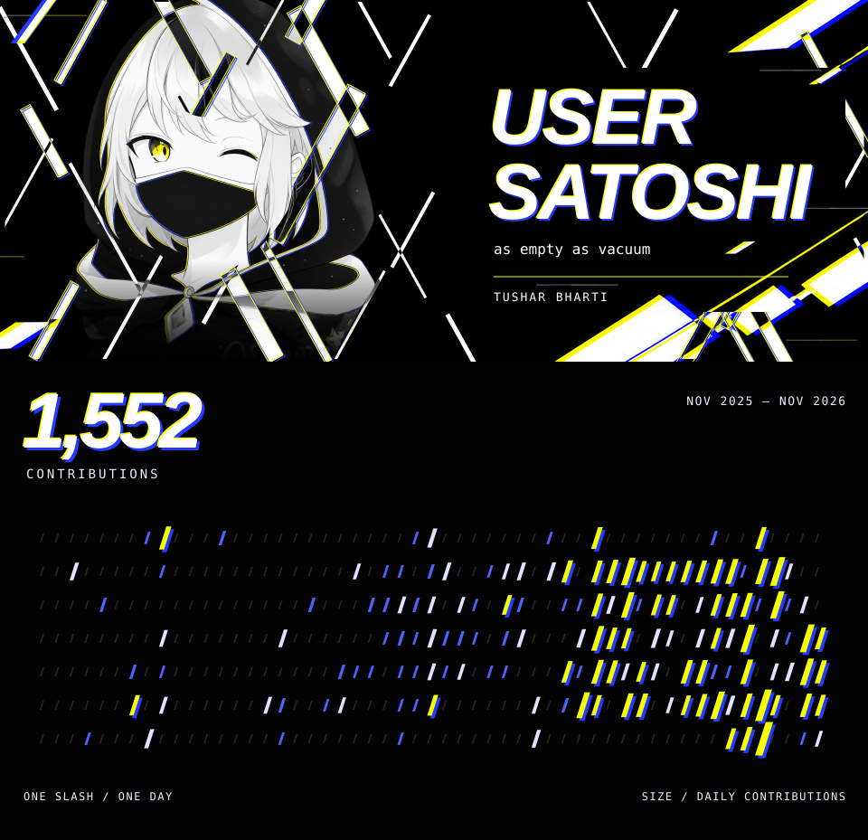
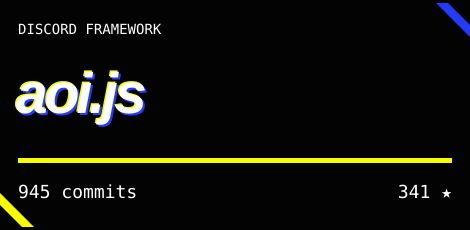
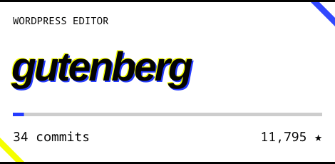
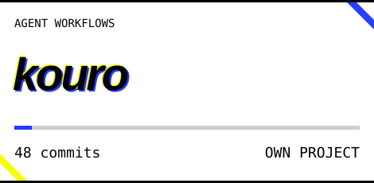
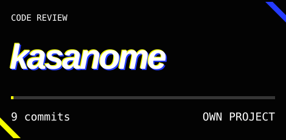
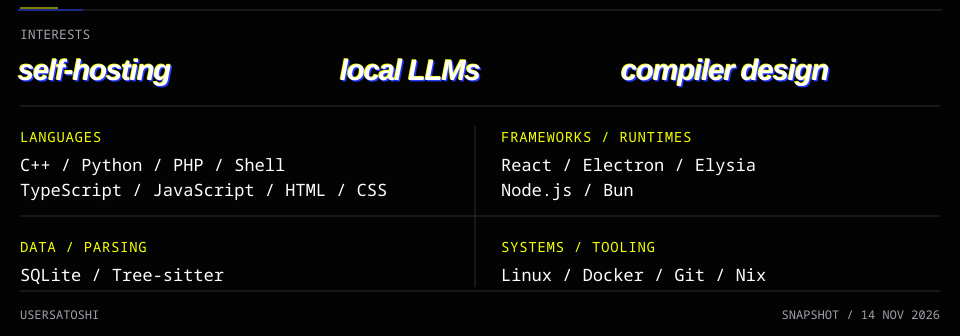

<picture>
  <source media="(max-width: 600px)" srcset="./assets/header-mobile.png">
  
</picture>

<a href="https://github.com/aoijs/aoi.js"><picture>
  <source media="(prefers-reduced-motion: reduce) and (max-width: 600px)" srcset="./assets/card-aoi-mobile.png">
  <source media="(prefers-reduced-motion: reduce)" srcset="./assets/card-aoi.png">
  <source media="(max-width: 600px)" srcset="./assets/card-aoi-mobile.gif">
  
</picture></a>
<a href="https://github.com/WordPress/gutenberg"><picture>
  <source media="(prefers-reduced-motion: reduce) and (max-width: 600px)" srcset="./assets/card-gutenberg-mobile.png">
  <source media="(prefers-reduced-motion: reduce)" srcset="./assets/card-gutenberg.png">
  <source media="(max-width: 600px)" srcset="./assets/card-gutenberg-mobile.gif">
  
</picture></a>
 
<a href="https://github.com/USERSATOSHI/kouro"><picture>
  <source media="(prefers-reduced-motion: reduce) and (max-width: 600px)" srcset="./assets/card-kouro-mobile.png">
  <source media="(prefers-reduced-motion: reduce)" srcset="./assets/card-kouro.png">
  <source media="(max-width: 600px)" srcset="./assets/card-kouro-mobile.gif">
  
</picture></a>
<a href="https://github.com/USERSATOSHI/kasanome"><picture>
  <source media="(prefers-reduced-motion: reduce) and (max-width: 600px)" srcset="./assets/card-kasanome-mobile.png">
  <source media="(prefers-reduced-motion: reduce)" srcset="./assets/card-kasanome.png">
  <source media="(max-width: 600px)" srcset="./assets/card-kasanome-mobile.gif">
  
</picture></a>

<!-- profile-about -->
<picture>
  <source media="(max-width: 600px)" srcset="./assets/about-mobile.png">
  
</picture>
